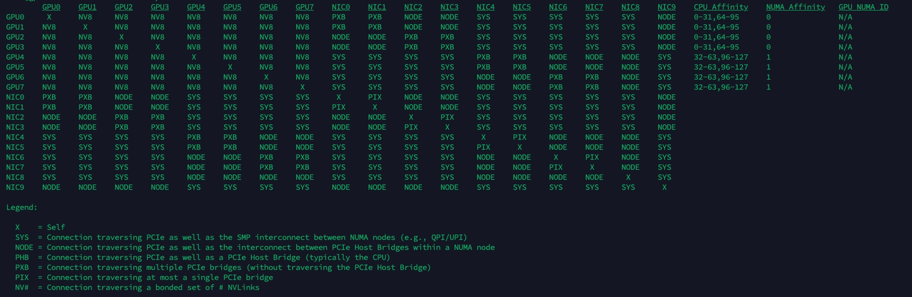
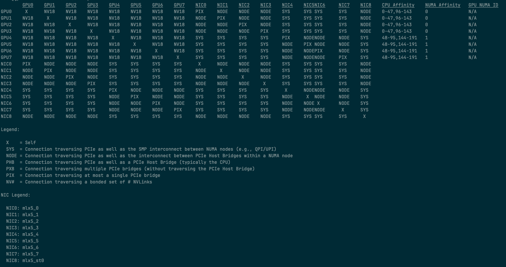

### Check GPU and NIC Topology

**Purpose**

Inspect the system topology and connectivity between GPUs, RDMA NICs, CPUs, and NUMA nodes.

Verify GPU-to-GPU and GPU-to-NIC communication paths to ensure that the hardware topology matches the expected server architecture.

An unexpected topology may introduce additional PCIe switch hops, NUMA cross-node communication, or longer data transfer paths, potentially affecting NCCL communication and GPUDirect RDMA performance.

**Command**

```bash
# Display GPU, NIC, and CPU/NUMA topology
nvidia-smi topo -m

# Display PCIe-only topology, excluding NVLink connections
nvidia-smi topo -mp

# Display GPU and PCIe device hierarchy
lspci -tv

# Display detailed hardware topology
lstopo
```
**A800 topo**


**H100 topo**


**Expected Result**

- GPU-to-GPU connectivity matches the expected hardware architecture.
- GPU-to-NIC connectivity matches the server's PCIe and NUMA design.
- GPU connections use the expected NVLink or PCIe paths.
- GPU and RDMA NIC devices are connected to the expected PCIe switches and root complexes.
- GPU CPU Affinity and NUMA Affinity match the expected hardware topology.
- No unexpected cross-NUMA communication paths or additional PCIe switch hops are detected.

Pay attention to the following topology indicators:

| Indicator | Description |
|---|---|
| X | Self |
| NV# | Connection through a bonded set of # NVLinks |
| PIX | Connection through a single PCIe switch |
| PXB | Connection through multiple PCIe switches without traversing a PCIe Host Bridge |
| PHB | Connection through a PCIe Host Bridge, typically the CPU |
| NODE | Connection through multiple PCIe Host Bridges within the same NUMA node |
| SYS | Connection traversing PCIe and the SMP interconnect between NUMA nodes |

**Abnormal Symptoms**

- GPU-to-GPU topology differs from the expected NVLink or PCIe architecture.
- Expected NVLink connections are missing or replaced by unexpected PCIe paths.
- GPU-to-NIC communication paths traverse unexpected PCIe switches or CPU root complexes.
- GPU and NIC devices are connected to different NUMA nodes when local connectivity is expected.
- GPU CPU Affinity or NUMA Affinity differs from the server hardware design.
- Unexpected `SYS`, `NODE`, or `PHB` paths introduce additional communication overhead.
- GPU or NIC devices are missing from the topology matrix.

**Troubleshooting**

- Inspect GPU-to-GPU and GPU-to-NIC connectivity using `nvidia-smi topo -m`.
- Compare the topology matrix with a healthy node using the same server hardware configuration.
- Check NVLink status using `nvidia-smi nvlink -s`.
- Verify PCIe topology and device hierarchy using `lspci -tv` and `lstopo`.
- Check GPU and NIC PCI Bus IDs to identify their PCIe root complexes and switches.
- Verify CPU and NUMA affinity using `numactl -H` and `lstopo`.
- Check whether GPU and RDMA NIC devices are located on the expected NUMA nodes.
- Inspect PCIe link speed and width using `lspci -vv`.
- Verify GPU P2P capabilities using `nvidia-smi topo -p2p r` and `nvidia-smi topo -p2p w`.
- Validate actual GPU-to-GPU and GPU-to-NIC communication performance using NCCL Tests and RDMA bandwidth tests.

**Note**

- `nvidia-smi topo -m` reports hardware connectivity and topology relationships. It does not directly measure actual communication bandwidth or guarantee that P2P communication is functional.
- `NV#` indicates a bonded set of NVLinks, not the actual measured NVLink bandwidth.
- `SYS`, `NODE`, `PHB`, `PXB`, and `PIX` describe different PCIe traversal paths. Their suitability depends on the expected server architecture.
- A topology containing `SYS` or `PHB` is not necessarily abnormal. Evaluate the results against the platform-specific hardware design.
- Use `nvidia-smi topo -p2p` and actual bandwidth tests to further validate GPU communication capabilities and performance.