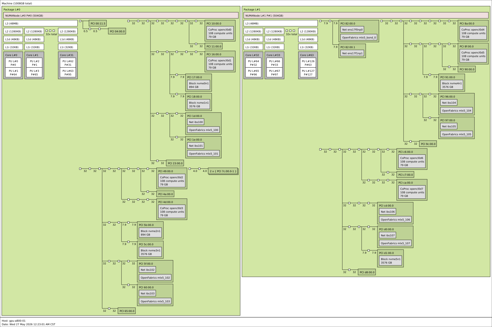
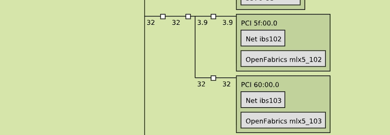

### Check PCIe ACS Configuration

**Purpose**

Verify PCIe Access Control Services (ACS) configuration to ensure that PCIe peer-to-peer (P2P) communication between GPUs and RDMA NICs works as expected.

Incorrect ACS redirection settings may redirect PCIe P2P traffic through the CPU root complex instead of allowing direct peer-to-peer communication, potentially causing reduced GPUDirect RDMA performance or communication failures.

**Command**

```bash
# Check ACS configuration on PCIe devices
sudo lspci -D -vvv | grep -E '^[[:xdigit:]]{4}:|ACSCap:|ACSCtl:'

# Inspect the full ACS configuration of a specific PCIe bridge
sudo lspci -D -s <PCI_BDF> -vvv

# Check PCIe topology
sudo lspci -tv

# Check GPU topology
nvidia-smi topo -m
```

**Expected Result**

- ACS configuration on PCIe bridges matches the platform-specific hardware and GPU Direct requirements.
- No unexpected PCIe P2P Request Redirect or Completion Redirect on bridges where direct P2P communication is required.
- GPU-to-GPU and GPU-to-NIC PCIe communication paths comply with the platform design.
- IOMMU configuration matches the requirements of the target GPU P2P / GPUDirect RDMA configuration.

Pay attention to the following ACS control flags in `lspci -vvv` output:

- `ReqRedir+`: ACS P2P Request Redirect is enabled.
- `CmpltRedir+`: ACS P2P Completion Redirect is enabled.
- `UpstreamFwd+`: ACS Upstream Forwarding is enabled.
- `SrcValid+`: ACS Source Validation is enabled.

Note that `SrcValid+` alone does not necessarily indicate that P2P traffic is being redirected. Inspect the complete ACS configuration and compare it against the platform-specific requirements.

**Abnormal Symptoms**

- Unexpected ACS Request Redirect or Completion Redirect is enabled on PCIe bridges along the GPU-to-NIC or GPU-to-GPU communication path.
- GPU P2P communication is unavailable or performs below expectations.
- GPUDirect RDMA traffic is redirected through the CPU root complex.
- NCCL communication experiences low bandwidth, performance degradation, or hangs.
- ACS configuration differs from the recommended BIOS or platform configuration.

**Troubleshooting**

- Inspect the PCIe topology using `lspci -tv` and `nvidia-smi topo -m` to identify the communication paths between GPUs and RDMA NICs.
- Check ACS Capability and Control registers on the relevant PCIe bridges using `lspci -vvv`.
- Inspect IOMMU configuration using the following commands:

```bash
cat /proc/cmdline
dmesg | grep -iE 'iommu|dmar|default domain'
```

- Verify BIOS settings related to PCIe ACS, VT-d, and IOMMU according to the platform vendor's recommendations.
- For Broadcom PLX PCIe switches, check whether ACS can be configured through the OS using `setpci`, following the hardware vendor's instructions.
- If ACS configuration is modified through `setpci`, verify the changes and ensure they persist after system reboot.
- Validate GPU P2P connectivity using `nvidia-smi topo -p2p p`.
- Validate GPUDirect RDMA and NCCL communication performance after configuration changes.
- Compare ACS settings and PCIe topology with healthy nodes.

**Note**

- Do not blindly disable all ACS features across PCIe devices. Some platforms require specific ACS bits to remain enabled.
- Disabling ACS may affect PCIe device isolation and virtualization security.
- Virtualized environments may require ACS for device isolation. Do not disable ACS on virtual machines without checking the platform requirements.
- IOMMU and ACS are separate PCIe-related mechanisms and should be checked independently.

### Check PCIe Topology and Link Bandwidth

**Purpose**

Validate PCIe topology and connectivity between CPUs, GPUs, and RDMA NICs.

Identify abnormal PCIe topology, unexpected device placement, and link bandwidth degradation that may affect GPU-to-GPU and GPU-to-NIC communication performance.

**Command**

```bash
# Install hwloc
sudo apt-get update
sudo apt-get install -y hwloc

# Generate PCIe topology diagram in SVG format
lstopo --of svg - > /opt/$(hostname)-pci.svg

# Display PCIe device hierarchy
lspci -tv

# Check PCIe link speed and width for a specific device
sudo lspci -D -vv -s <PCI_BDF> | grep -E 'LnkCap:|LnkSta:'
```

**Expected Result**

- PCIe topology matches the expected server hardware architecture.
- All GPUs and RDMA NICs are correctly detected and connected to the expected PCIe root complexes and switches.
- GPU and NIC PCIe connectivity matches the platform design.
- PCIe link bandwidth matches the expected generation and lane width.
- No unexpected PCIe bandwidth degradation or abnormal device connectivity is detected.

For example, a PCIe Gen4 x16 link should provide approximately 31.5 GB/s theoretical bandwidth per direction, while a PCIe Gen3 x4 link provides approximately 3.9 GB/s.

**Abnormal Symptoms**

- PCIe topology differs from the expected hardware design.
- GPU or RDMA NIC devices are connected through unexpected PCIe paths.
- PCIe link bandwidth is significantly lower than expected.
- A PCIe link expected to provide approximately 32 GB/s only shows approximately 3.9 GB/s in the topology diagram.
- GPU or NIC PCIe link width is downgraded, such as x16 to x4.
- PCIe devices are missing or incorrectly enumerated.

**Troubleshooting**

- Generate and inspect the PCIe topology diagram using `lstopo`.
- Compare the PCIe topology with a healthy node of the same hardware configuration.
- Identify the PCI BDF of the affected GPU or RDMA NIC using `lspci`.
- Check PCIe Link Capability (`LnkCap`) and Link Status (`LnkSta`) using `lspci -vv` to identify link speed or width downgrade.
- Inspect PCIe root complexes, switches, bridges, and NUMA topology.
- Check PCIe AER logs for link errors and communication failures.
- Inspect PCIe slots, risers, cables, and hardware connections.
- Verify BIOS PCIe generation and lane configuration.
- Compare GPU and NIC PCIe connectivity against the server manufacturer's hardware specifications.

**Reference Images**

Healthy PCIe topology:



Abnormal PCIe link bandwidth:



**Note**

- `lstopo` displays the aggregate data rate of a PCIe link in GB/s, not the PCIe lane width directly.
- Use `lspci -vv` to verify the actual negotiated PCIe Link Speed and Link Width.
- PCIe bandwidth expectations depend on PCIe generation, lane width, and platform design.
- Do not treat every low bandwidth value as a hardware failure. Compare the link against the expected configuration of the specific PCIe device and bridge.